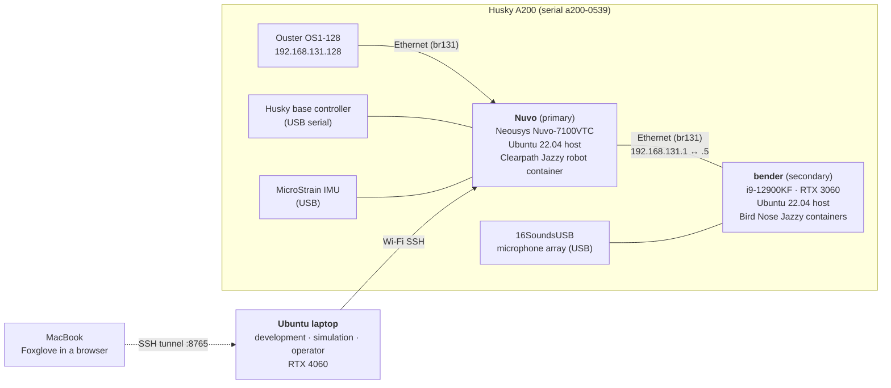
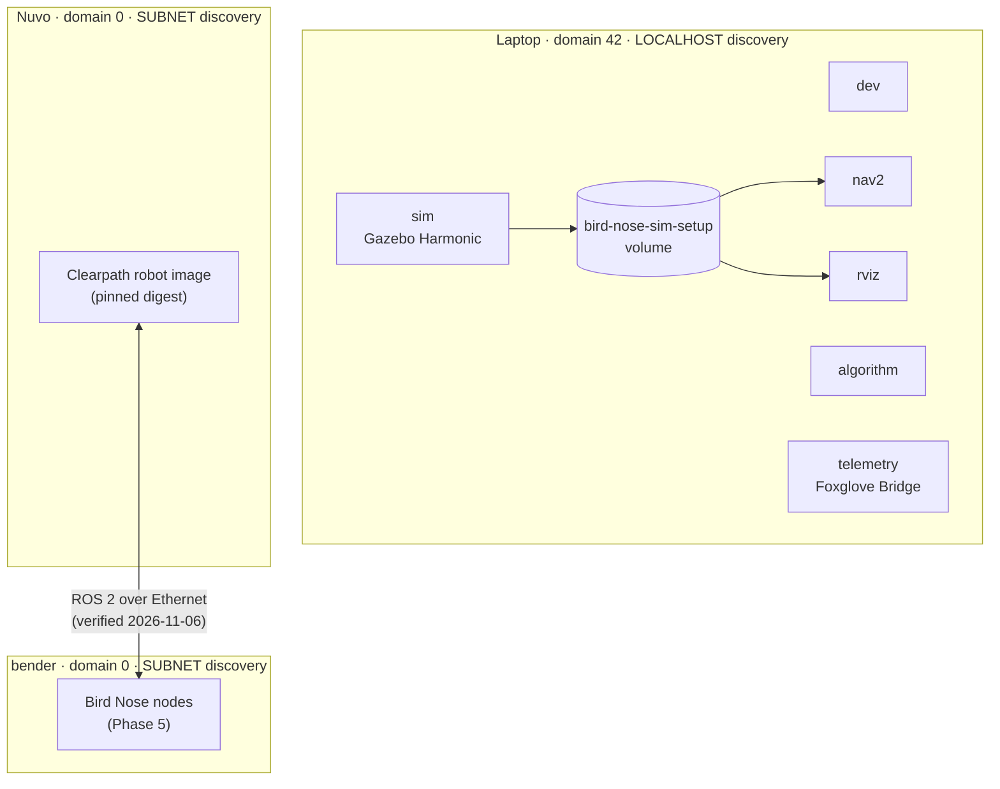
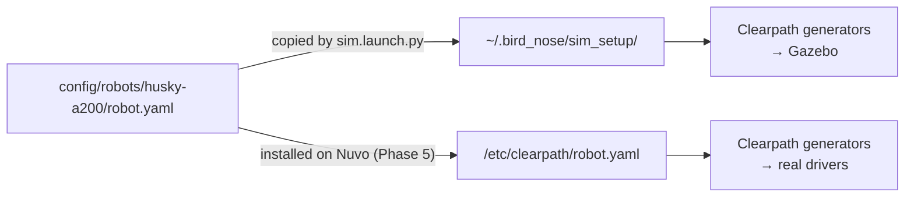

# Architecture

How Bird Nose's software maps onto its computers, containers, and networks. The decisions behind it, and their dates, live in the team's living architecture doc; this page describes the result.

## The computers

- **Nuvo** runs Clearpath's robot stack: base driver, IMU, joystick teleop, and (for now) the Ouster driver. Its software bridge `br131` acts as a switch for the robot network.
- **bender** runs Bird Nose's heavier work: audio, and later any GPU processing. Because `br131` is a switch, bender can receive the Ouster's data directly even though the cable plugs into Nuvo. Which computer runs each sensor driver is settled in Phase 5.
- **The laptop** is where code is written, built, and simulated, and where an operator watches the robot.
- **The MacBook** never runs ROS; it views telemetry through Foxglove.

## Containers on each computer

Every computer runs ROS 2 Jazzy inside containers. The hosts provide only Docker, drivers, the network, and the clock.

All laptop services share the image `bird-nose-dev:jazzy`, built from `containers/Dockerfile`. Nuvo uses Clearpath's published robot image, pinned to the digest that has already driven the robot.

## Simulation and the robot stay apart

| | Laptop (dev and sim) | Robot (Nuvo and bender) |
| --- | --- | --- |
| `ROS_DOMAIN_ID` | 42 | 0 |
| Discovery range | `LOCALHOST` | `SUBNET` |
| Middleware | Fast DDS | Fast DDS |
| Started by | `containers/compose.yaml` | `containers/compose.hardware.yaml` (Phase 5) |

Two independent barriers: a different domain means the two sides ignore each other's messages, and localhost discovery means simulation never even advertises itself on the network.

## One robot description, two worlds

The simulator and the robot read the same file, so they publish the same topic names under the same namespace (`/Nuvo_7100VTC_Series`). Code written against the simulation runs against the robot unchanged. The file is copied in both cases because Clearpath's generators write their output next to it.

## Repository map

| Path | Role | Docs |
| --- | --- | --- |
| `containers/` | Image and services | [README](../containers/README.md) |
| `config/` | Robot, host roles, scenarios | [README](../config/README.md) |
| `src/bird_nose_bringup` | Launch entry points | [README](../src/bird_nose_bringup/README.md) |
| `src/bird_nose_description` | Bird Nose payloads in the robot model | [README](../src/bird_nose_description/README.md) |
| `src/bird_nose_navigation` | Nav2 configuration | [README](../src/bird_nose_navigation/README.md) |
| `src/bird_nose_sim` | Worlds and assets | [README](../src/bird_nose_sim/README.md) |
| `src/bird_nose_algorithms` | Autonomy nodes | [README](../src/bird_nose_algorithms/README.md) |
| `src/bird_nose_telemetry` | Foxglove and recording | [README](../src/bird_nose_telemetry/README.md) |
| `tools/` | Host scripts and robot scripts | [README](../tools/README.md) |
| `data/` | Local recordings and reports | [README](../data/README.md) |

New terms are defined in the [glossary](glossary.md).
